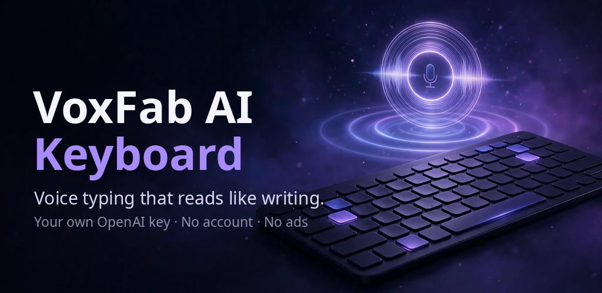
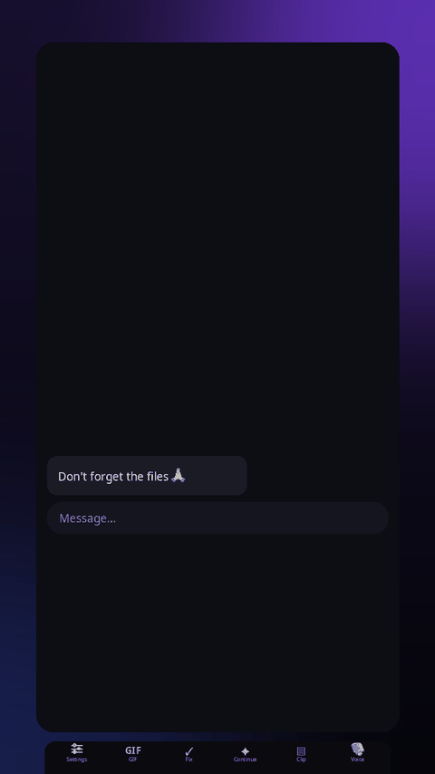
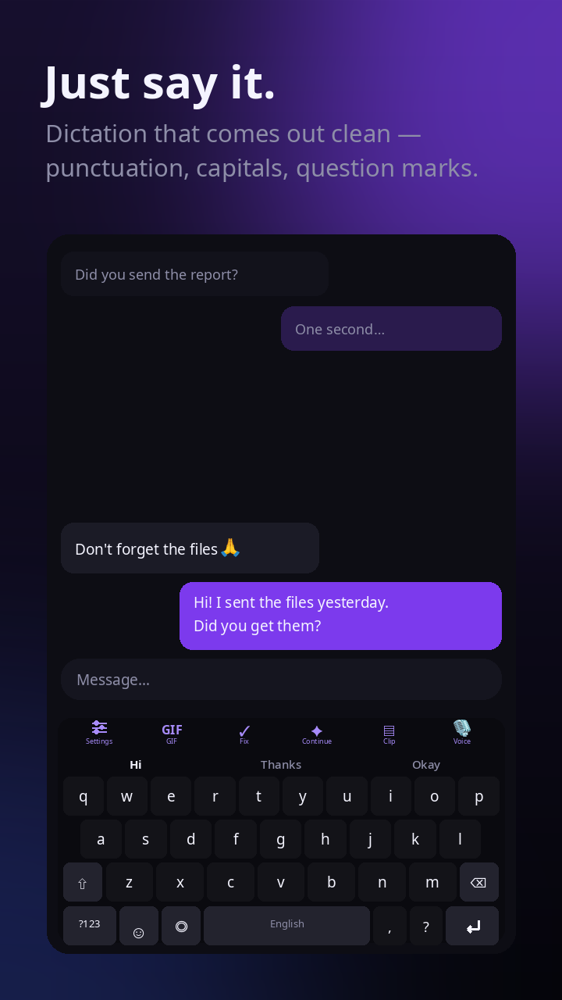
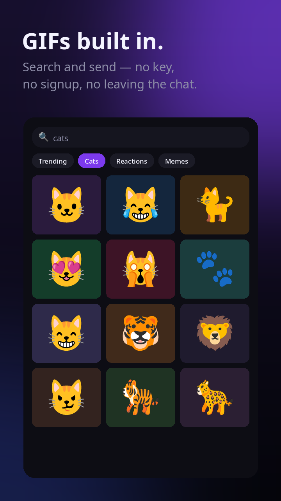
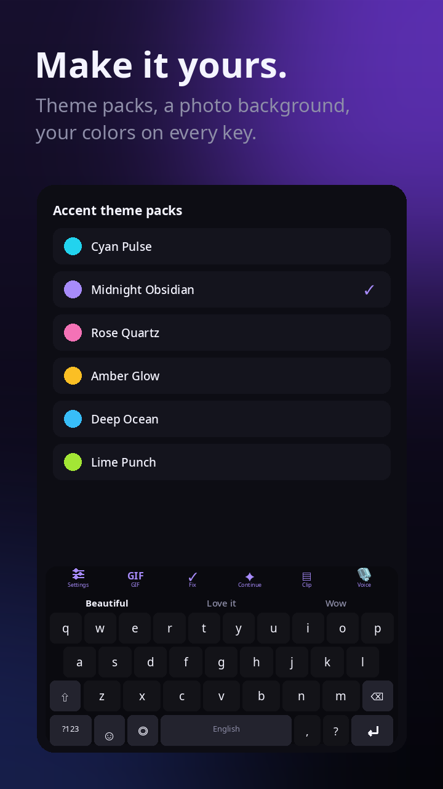
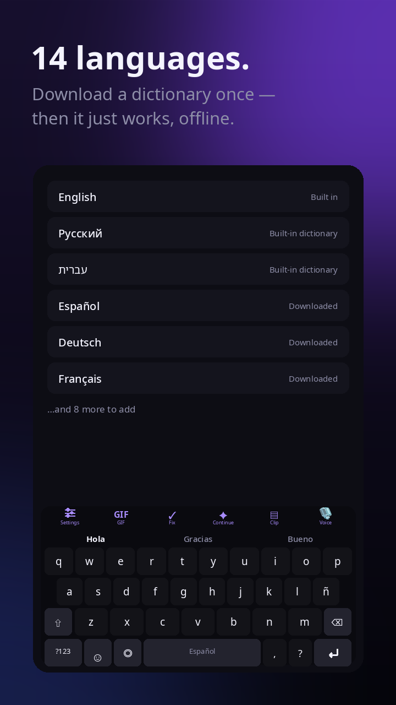
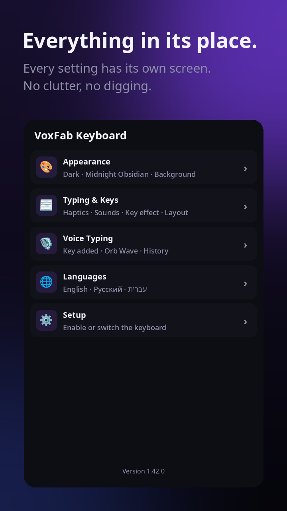

# VoxFab AI Keyboard

**The Android keyboard that runs on YOUR OWN OpenAI API key.**

Bring your own key (BYOK), paste it in once, and dictate with Whisper +
GPT formatting as much as you want. **No subscription. No account.
No "free trial". No 20-words-a-day limits.**

**[⬇ Download the latest APK](https://github.com/icelanderus/VoxFab-AI-Keyboard/releases/latest/download/VoxFabKeyboard.apk)**

Current version: **1.42.0**

## Why your own API key?

Every other voice keyboard wants $10–20 a month, forever, for the exact
same OpenAI models — plus an account, plus a word cap when the "trial"
ends.

With your own key you pay OpenAI's raw price instead: dictation costs
about **$0.006 per minute** — an hour of talking is roughly 36 cents —
and formatting a message costs a fraction of a cent. No middleman, no
markup, no cap. Your key, your keyboard, your money stays yours.

## What it does

- **Voice typing that reads like writing.** Dictate and the text comes
  out formatted — sentence breaks, capital letters, question marks where
  you asked something. Your exact words are never changed, punctuation
  only.
- **Fix & Continue.** One tap fixes the grammar of what you typed;
  another continues your text in the same style (gpt-4o-mini, your key).
- **Keyless GIF search.** Search and send GIFs right from the keyboard —
  no API key, no signup.
- **Clipboard with a memory.** Everything you copy is kept in a history
  list (up to 50), not just the last item. Things that look like keys or
  passwords are never stored.
- **Languages on demand.** English is built in. Russian and Hebrew come
  with dictionaries inside the app; Spanish, German, French, Italian,
  Portuguese, Turkish, Polish, Greek, Dutch, Swedish, Ukrainian and more
  download their dictionary once (~1 MB) and then work fully offline.
- **Make it yours.** Accent theme packs, a photo background with blur
  and dim, key text color, optional number row, symbols on letter keys
  (long-press), key press effects, haptics and key sounds — or full
  silence.
- **It learns your words.** Personal dictionary from what you type, plus
  context-aware suggestions and typo corrections.

## Screenshots

## Install

1. Download the APK from the link above.
2. Open it and allow installing from the browser when Android asks
   (this is normal for apps installed outside Google Play).
3. Open the VoxFab Keyboard app → **Setup** → enable the keyboard and
   switch to it.
4. **Voice Typing** → paste your OpenAI API key. That's it — dictate
   away. (Typing, GIFs, emoji and themes work without a key.)

## Privacy

- The key is stored **only on your phone** and sent **only to OpenAI**.
- What you type — including the learned dictionary and the clipboard
  history — **never leaves the device**.
- Audio is sent to OpenAI only while you dictate, for transcription.
- There is no analytics, no ads and no third-party SDK tracking
  anything.

## Notes

- This repository is the public download page. The source code is not
  published here.
- Android may warn that the app comes from outside Google Play — that
  is expected for direct APK installs. The APK is signed with the
  developer's release key, and every version is an update of the same
  app.
